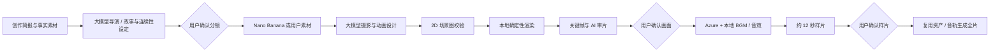

# Movie Studio engine

目标：用户给创作意图，大模型承担导演和动态设计；本地引擎掌握素材、时间、画面、声音与输出。
引擎不以 subgroup matrix 为前提，也不调用 Pika / Seedance 等视频生成平台。

## 五层边界

| 层 | 负责 | 不负责 |
|---|---|---|
| 导演 | 故事、镜头目的、节奏、连续性 bible、来源 | 编造事实、替用户确认 |
| 美术与资产 | Nano Banana 候选帧、用户素材、连续性参考图 | 把准确图表 / 数字烧进生成图 |
| 编排器 | 大模型把镜头意图编译为可执行 2D 场景数据 | 在本机执行任意模型生成的 JS / shell |
| 渲染与声音 | 图层、轨迹、路径、粒子、字幕、音乐、音效、编码 | 临时改故事、暗中换模型或外部视频平台 |
| 审片 | 校验、实际静帧检查、样片、人类确认、证据记录 | 承诺所有生成必然是好作品 |

## 2D 场景契约 v1

`src/engine/schema.mjs` 是可执行校验；`renderer.mjs` 和 `motion.mjs` 是自有运行时。
`director.mjs` 负责把批准的镜头编译为场景，并进行实际静帧审阅。

- 节点：矩形、椭圆、文字、线、路径、图片、确定性粒子。
- 坐标：x/y 为画布比例，节点中心为锚点；w/h 为画布比例。
- 动画：按秒的关键帧，移动、尺寸、旋转、缩放、透明度、圆角、路径展开；明确缓动。
- 相机：归一化关注点、缩放、旋转和独立关键帧。
- 声音：tick、whoosh、impact、chime，时间与图像动作共用秒数。
- 上限：每镜 60 图层，每属性 30 个关键帧，粒子最多 300；禁止文件路径逃逸和未知节点。
- 不使用 eval / Function / 任意模型代码。错误方案最多进行一次模型修复，不无限抽卡。

任意时刻可以单独渲染，乱序渲染不会改变结果。浏览器和离线 MP4 使用同一运行时。
横屏和竖屏以相同的归一化坐标表达；布局由导演按画幅设计，不是裁掉横屏两侧。

既有精确技术图表仍可使用领域绘图器 `src/film.mjs`。普通影片通过 `composition`
走通用引擎，不必增加一个新的硬编码 scene kind 才能做新故事。

## 质量与可恢复性

项目、引擎代码和图像内容共同决定输出指纹；更改会使旧画面 / 样片确认失效。
语音按内容缓存。参考图、提示词、模型和时间保存在资产旁。
帧审查读取真实生成的 PNG，不凭提示词判断画质；报告明确只抽查静帧。
最后仍需要样片预览，以判断连续运动、表演、声画节奏和听感。

当前音效和配乐是原创程序化合成，尚无完整角色绑定、口型、视频素材剪辑、多音轨编辑
或通用物理模拟。大模型能编排现有图层与动作，但不能因为一条提示就让运行时具备
尚未实现的能力。后续优先扩展 2D 图层、蒙版、对象关系和审片反馈，再接 Blender。

## 验收

`npm test` 验证状态、几何、时间、确定性和输入契约；`npm run test:ui` 验证用户操作。
`npm run test:workflow` 实际走分镜确认、模型编排、关键画面审阅、Azure、样片、
样片确认和全片。测试使用临时作品，不能借测试替首部作品记录用户批准。
# 已批准版本与引擎修复

渲染指纹仍包含创作输入、素材字节和相关引擎源码。技术修复改变指纹时，默认不会继承
旧确认。仅当原创作输入、视觉代码与素材保持一致，并重新生成出与原批准样片逐字节相同
的 MP4，才可通过 `scripts/check-engine-equivalence.mjs` 记录一次精确的本机等价证明。
该工具还会用指定 Git 版本重算旧指纹，检查当前素材确实属于旧批准版本。

证明位于被忽略的 `.studio-local/approval-equivalence/`，绑定作品 ID、新旧指纹和实际
样片 SHA-256；每次使用都检查原批准记录和两份媒体。它不修改 `project.review`，也不
适用于其他代码版本、内容修改或不同样片。已完成且等价的旧片继续显示原文件；新渲染
仍写入新指纹目录。缺少证明或样片发生变化时，按正常流程重新审阅。
